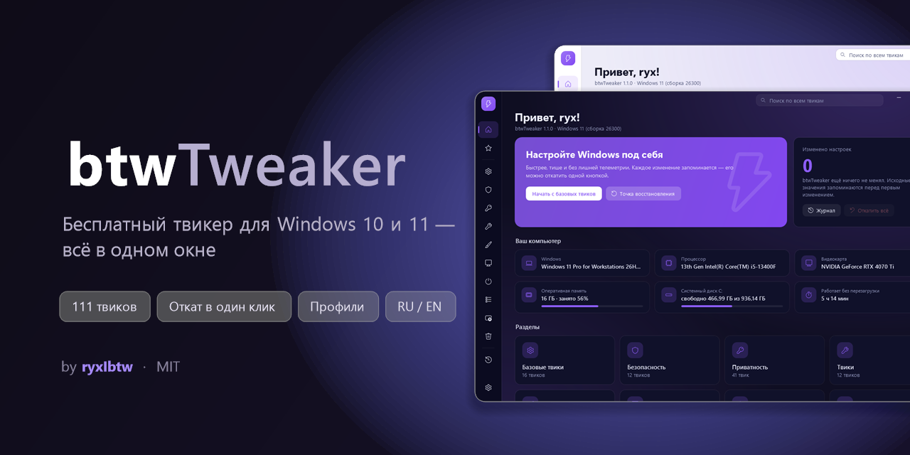
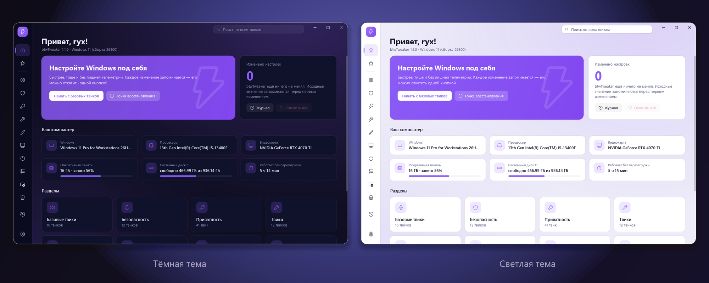
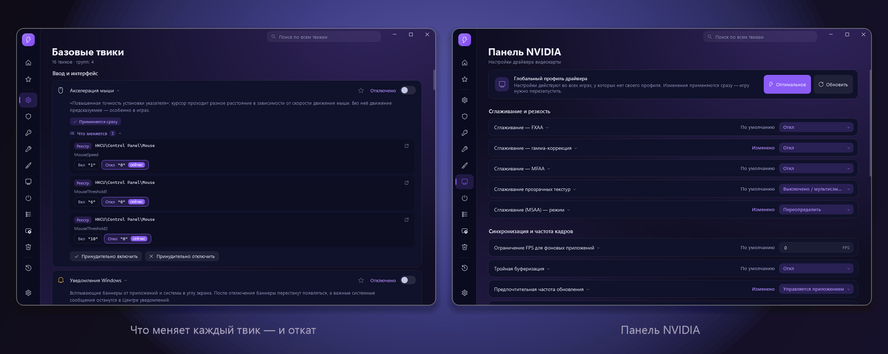
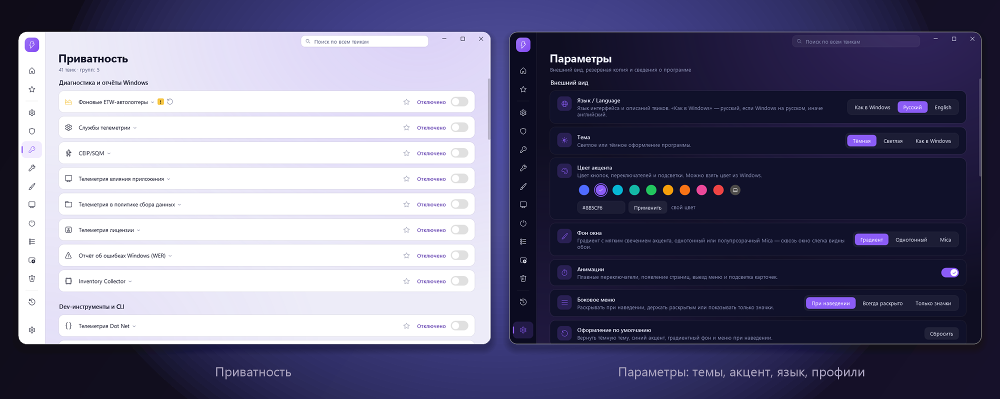

# btwTweaker



Бесплатный твикер для **Windows 10 и 11**: телеметрия, службы, безопасность, приватность, внешний вид, NVIDIA, автозагрузка и очистка диска — в одном окне. Каждое изменение запоминается и откатывается.
Автор — **ryxIbtw**. Без PRO-версий, рекламы и регистрации.

**Скачать:** [btwTweaker.exe](https://github.com/ryxIbtw/btwTweaker/releases/latest/download/btwTweaker.exe) · [Все версии](https://github.com/ryxIbtw/btwTweaker/releases) · [Список изменений](CHANGELOG.md)

[English below](#english)

## Установка

1. Скачайте `btwTweaker.exe` — это один файл, устанавливать ничего не нужно.
2. Запустите. Windows попросит права администратора: без них нельзя менять системные настройки.
3. При первом запуске программа предложит создать точку восстановления — рекомендуем согласиться.

## Возможности



**Твики — 111 настроек в 5 разделах**
- **Базовые твики** — акселерация мыши, уведомления, Windows Update (включено / пауза / отключено), автообновление драйверов и Магазина, оптимизация доставки, индексация, SysMain, печать, Edge в фоне, Game Bar, игровой режим, HAGS.
- **Безопасность** — Defender, SmartScreen, брандмауэр, AMSI, VBS, автошифрование, UAC, Spectre v2, HDCP, LLMNR. Всё, что снижает защиту, отмечено красным щитом и спрашивает подтверждение.
- **Приватность** — телеметрия Windows, .NET, PowerShell, Visual Studio и VS Code, задания планировщика, реклама, местоположение, облачная синхронизация и 19 разрешений приложений.
- **Твики** — Win32PrioritySeparation, разделение svchost, Raw Input, имена 8.3 и последний доступ NTFS, хранилище обновлений, обслуживание и диагностика.
- **Кастомизация** — визуальные эффекты, прозрачность, поиск без Bing, Copilot, виджеты, «Пуск» без рекламы, контекстное меню Windows 10, секунды в часах, залипание клавиш и многое другое.
- Программа показывает **реальное состояние** каждой настройки, прочитанное из системы, а не то, что когда-то нажали.

**Подробности каждого твика**
- Раскройте карточку — там описание, метки («нужна перезагрузка», «только Windows 11») и блоки «Снижает защиту» и «Учтите».
- **«Что меняется»**: все ключи реестра, службы и задания, которые трогает твик, со значениями для «Вкл» и «Откл» и отметкой «сейчас». Ключ открывается в редакторе реестра одной кнопкой.
- «Принудительно включить / отключить» записывает все значения, даже если часть меняли вручную.



**Особые разделы**
- **Панель NVIDIA** — 19 настроек глобального профиля драйвера: сглаживание, V-Sync, ограничение FPS, режим низкой задержки, питание, CUDA P2, фильтрация текстур. Метки «По умолчанию / Изменено» и кнопка «Оптимальное».
- **Электропитание** — выбор, удаление и добавление схем, включая «Максимальную производительность».
- **Выпиливание** — удаление встроенных приложений с иконками и размером, OneDrive и Edge (WebView2 не трогается), запрет автоустановки Teams. Магазин и системные пакеты защищены.
- **Автозагрузки** — ключи реестра, приложения Магазина, папки, задания и сторонние службы. Влияние на запуск, отложенный запуск, поиск битых записей, экспорт в CSV.
- **Очистка** — временные файлы, кэши Windows, видеокарты, браузеров и инструментов разработчика, остатки UWP, следы активности, отключённые устройства. Размер виден до очистки.

**Безопасно для системы**
- Перед первым изменением каждой настройки сохраняется исходное значение. **«Откатить всё»** возвращает всё как было.
- **Журнал изменений**: каждое действие и состояние перед ним — любое можно откатить отдельно.
- **Проверка сброса**: крупные обновления Windows иногда возвращают настройки. При запуске btwTweaker сверит твики, которые вы меняли, и предложит вернуть.
- Точка восстановления Windows — одной кнопкой.

**Удобство**
- **Мои твики** — звёздочка у любого твика собирает избранное на одной странице.
- **Профили** — сохраните все твики в файл `.btwprofile` и примените на другом компьютере. Программа покажет, что отличается, и даст выбрать галочками.
- Поиск по всем твикам сразу.
- **Русский и английский** — язык выбирается в Параметрах, по умолчанию как в Windows.
- **Обновления** с GitHub: программа скачивает новую версию, сверяет SHA256 и перезапускается. Прошлую версию можно вернуть.



**Внешний вид** — тёмная и светлая тема или как в Windows, любой цвет акцента, фон-градиент, однотонный или Mica (Windows 11), анимации и боковое меню: раскрывается при наведении, всегда раскрыто или только значки.

## Проверка файла

К каждому релизу приложен `btwTweaker.exe.sha256`. Сверить скачанный файл можно командой
`Get-FileHash btwTweaker.exe` в PowerShell.

## Сборка

Нужна только Windows: используется встроенный компилятор C# из .NET Framework 4.8. Интерфейс написан на WPF (`src\wpf`), логика — в `src\core`, перевод — `src\lang\en.tsv`; сторонних библиотек нет.

```
powershell -ExecutionPolicy Bypass -File build.ps1
```

## Лицензия

[MIT](LICENSE)

---

## English

A free tweaker for **Windows 10 and 11** by **ryxIbtw**: telemetry, services, security, privacy, appearance, NVIDIA, startup and disk cleanup — in one window. Every change is remembered and can be rolled back. No PRO version, ads or sign-up.

**Download:** [btwTweaker.exe](https://github.com/ryxIbtw/btwTweaker/releases/latest/download/btwTweaker.exe) — a single file, no installation (administrator rights are required).

Features: 111 tweaks in Basic, Security, Privacy, Tweaks and Customization sections, each showing its real state read from the system; a "What changes" list with every registry key, service and task a tweak touches; NVIDIA global profile settings with an "Optimal" preset; power plans; removal of built-in apps, OneDrive and Edge; startup manager with impact, delayed start and broken-entry cleanup; disk cleanup with sizes shown upfront; original values backup with "Roll back all", a change log with per-action rollback and a restore point button; reset check after Windows updates; favorites ("My tweaks"); profiles you can save to a file and apply on another PC; dark/light themes, accent color, gradient/solid/Mica background; Russian and English UI; self-update with SHA256 verification.

Each release ships `btwTweaker.exe.sha256`; compare it with `Get-FileHash btwTweaker.exe`.

Build: `powershell -ExecutionPolicy Bypass -File build.ps1`

License: [MIT](LICENSE).
